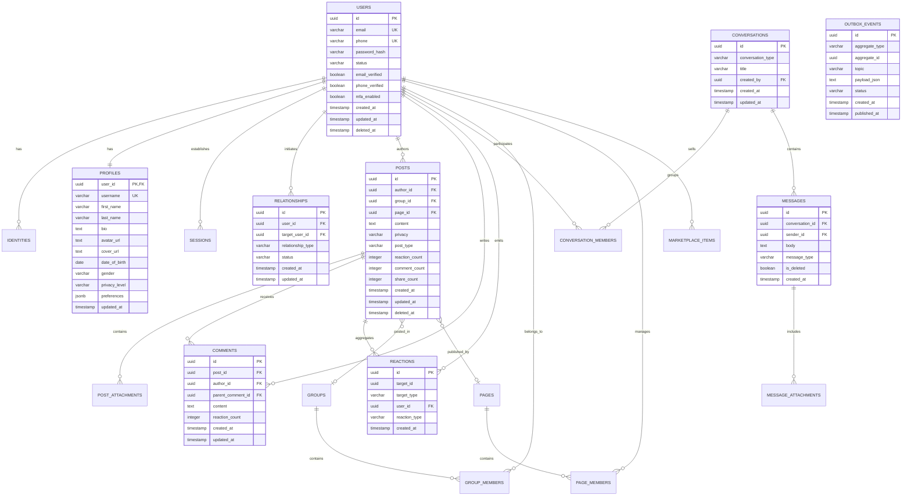

# Master Database Entity-Relationship Diagram (ERD)

## 1. Core Architectural Strategy
The database architecture employs PostgreSQL 16+ as the single source of truth (ACID transactional consistency), augmented with:
- **UUIDv7**: Time-ordered, cluster-friendly 128-bit unique identifiers for all primary keys.
- **Partitioning**: Range partitioning by month for high-throughput append-only tables (`posts`, `comments`, `reactions`, `messages`, `audit_logs`).
- **Transactional Outbox Table**: For zero-loss, asynchronous CDC/Kafka event publishing.

---

## 2. Mermaid Entity-Relationship Diagram

