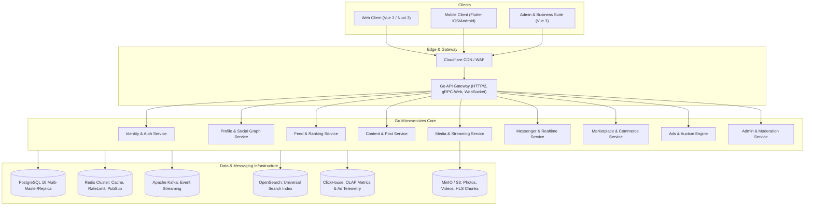

# Global Social Network System Architecture Overview

## 1. 하이레벨 아키텍처 다이어그램

---

## 2. 서비스 통신 및 프로토콜 규격
- **클라이언트 <-> Gateway:**
  - RESTful HTTP/2 (JSON/Protobuf) for standard queries & mutations
  - Secure WebSocket (`wss://`) for Messenger, Presence, and Notifications
  - WebRTC (STUN/TURN) for 1:1 and SFU Video Calls
- **Gateway <-> 마이크로서비스:**
  - gRPC over HTTP/2 with mutual TLS (mTLS)
- **비동기 이벤트 메시징:**
  - Apache Kafka topics with schema registry for domain lifecycle events
