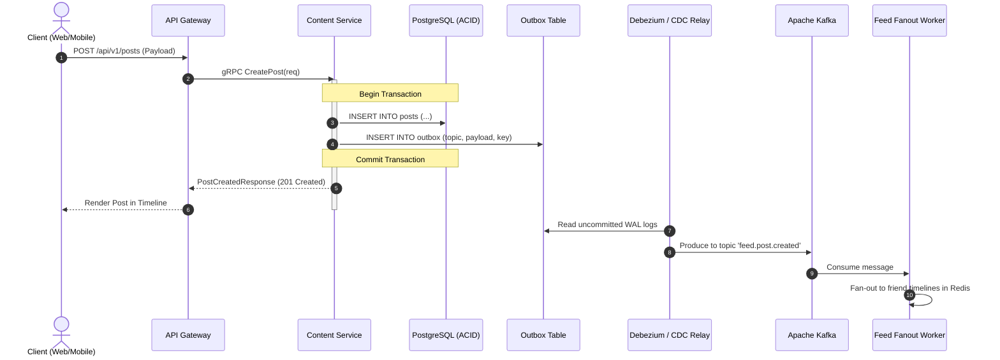

# User Action & Event Processing Catalog

## 1. Overview
Every user interaction in the frontends translates into a contractually defined sequence:
1. Client UI Action
2. API Gateway routing & auth validation
3. Domain Microservice RPC/HTTP handler
4. Database ACID Transaction & Transactional Outbox write
5. Kafka Event publication
6. Async consumer processing (Notifications, Feed Fan-out, Search indexing, Realtime WebSocket push)

---

## 2. Comprehensive Event Catalog

| Action ID | UI Trigger | API Endpoint | DB Table Mutated | Kafka Event Published | Downstream Consumers | Retry / Failure Policy |
|---|---|---|---|---|---|---|
| `ACT-001` | Register form submit | `POST /api/v1/auth/register` | `users`, `identities`, `audit_logs` | `identity.user.registered` | Email OTP Service, Fraud Detector | Idempotent on email; exponential backoff for OTP delivery |
| `ACT-002` | Login submit | `POST /api/v1/auth/login` | `sessions`, `login_history` | `identity.user.logged_in` | Security Anomaly Detector | Max 5 failed attempts per IP/minute -> Captcha challenge |
| `ACT-003` | Send friend request | `POST /api/v1/friends/request` | `relationships`, `outbox` | `socialgraph.friend.requested` | Notification Service (push + bell) | Idempotent key: `hash(requester+recipient)`; reject if duplicate |
| `ACT-004` | Accept friend request | `POST /api/v1/friends/accept` | `relationships`, `profiles` | `socialgraph.friend.accepted` | Feed fan-out initial sync, RecSys | Redis mutual friends set update; rollback on DB error |
| `ACT-005` | Post composer submit | `POST /api/v1/posts` | `posts`, `post_attachments`, `outbox`| `feed.post.created` | Feed Ingestion Worker, OpenSearch Indexer | S3 media must be confirmed uploaded before post commit |
| `ACT-006` | React to post (Like/etc)| `POST /api/v1/posts/:id/react`| `reactions`, `post_counters` | `feed.reaction.created` | Redis hyperloglog/counter, Notification | Upsert on `(post_id, user_id)`; debounced Redis buffer |
| `ACT-007` | Submit comment | `POST /api/v1/posts/:id/comments`| `comments`, `post_counters` | `content.comment.created` | Mention extractor, Auto-moderation | Rate limited 10 comments/min; spam score check |
| `ACT-008` | Send chat message | `POST /api/v1/messages` (WS fallback) | `messages`, `conversation_members` | `messaging.message.sent` | Realtime Gateway (WS), Push Notification | Client generated message UUID for deduplication |
| `ACT-009` | Create Market listing | `POST /api/v1/marketplace/items` | `marketplace_items`, `item_images` | `marketplace.item.listed` | OpenSearch Catalog Indexer | Image NSFW classification prior to state `ACTIVE` |
| `ACT-010` | Report content | `POST /api/v1/moderation/reports`| `reports`, `audit_logs` | `moderation.report.submitted` | Trust & Safety Priority Queue | High urgency auto-quarantine if report threshold > 5 |
| `ACT-011` | Join group | `POST /api/v1/groups/:id/join` | `group_memberships` | `groups.member.joined` | Group Admin Notification | Checks group privacy (PUBLIC vs CLOSED/PRIVATE) |
| `ACT-012` | Launch Ad campaign | `POST /api/v1/ads/campaigns` | `ad_campaigns`, `billing_holds` | `advertising.campaign.created` | Ad Delivery Bidding Engine | Pre-authorization credit card hold required |

---

## 3. Transactional Outbox Pattern Flow

To guarantee zero event loss between PostgreSQL and Apache Kafka:

