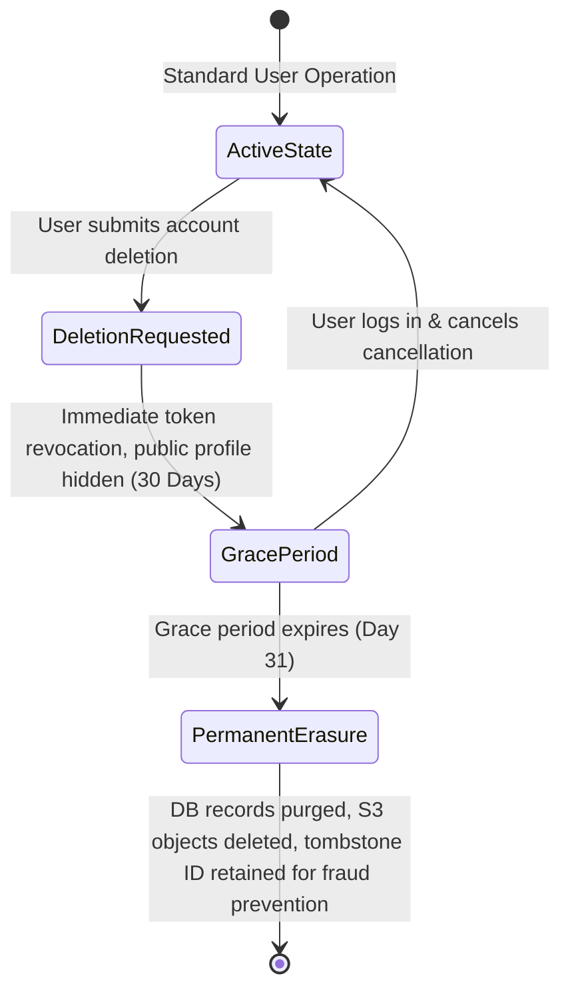

# Privacy Architecture & Data Protection Directive (GDPR / PIPA / CCPA)

## 1. Core Principles
1. **Data Minimization (Art. 5(1)(c) GDPR)**: Only personal identifiers strictly necessary for service execution (e.g., email or phone for authentication, hashed credentials) are collected.
2. **Purpose Limitation (Art. 5(1)(b) GDPR)**: Telemetry and ad targeting are strictly decoupled from operational credentials.
3. **Storage Limitation & Automatic TTL**: Ephemeral Stories expire at 24 hours; session tokens expire in 14 days unless renewed; deleted accounts undergo a 30-day grace period before cryptographic erasure.

---

## 2. Personal Data Lifecycle & Retention Matrix

| Data Category | Retention Period | Storage Engine | Deletion / Anonymization Mechanism | Legal Basis |
|---|---|---|---|---|
| **Auth Credentials & MFA** | Account lifetime + 30 days grace | PostgreSQL (Encrypted) | Hard cryptographic deletion on expiry | Contractual necessity |
| **User Profile Data** | Account lifetime | PostgreSQL & Redis | Soft delete (is_deleted=true) -> Hard delete post-grace | User consent |
| **Posts, Comments & Media** | Account lifetime or user deletion | S3 + PostgreSQL + OpenSearch | Soft delete immediately -> S3 lifecycle rule 30-day purge | User consent |
| **Stories (Ephemeral Media)** | Exactly 24 Hours | S3 Storage + Redis | Automated cron TTL; removed from public feed at 24h00m | Service feature contract |
| **Direct Chat Messages** | Retained until conversation deletion | PostgreSQL + Kafka archive | Bidirectional soft delete; masked for requester | Contractual necessity |
| **Financial / Payment Logs** | 5 Years (Statutory Tax Law) | Isolated Audit DB (WORM) | Retained strictly for tax audit compliance; anonymized | Legal obligation |
| **Security & Access Logs** | 90 Days | ClickHouse / Loki | Automated partition drop after 90 days | Legitimate interest (security) |

---

## 3. User Self-Service Privacy Rights

### 3.1 Right to Access & Data Portability (Download My Information)
- User requests download via `/settings/your-information/download`.
- An asynchronous Go worker exports a signed `.zip` package containing:
  - `profile.json`: User profile, contact details, account history.
  - `posts/`: All published posts, comments, reactions in JSON format.
  - `media/`: Original uploaded photos and videos in zip archive.
- Download link valid for 72 hours, protected by re-authentication (password or MFA challenge).

### 3.2 Right to Erasure (Account Deletion & Grace Period)

---

## 4. Data Protection Impact Assessment (DPIA) Checklist

- [x] **Encryption in Transit**: TLS 1.3 enforced on all API Gateway endpoints; strict HSTS enabled.
- [x] **Encryption at Rest**: AES-256 for PostgreSQL tablespaces; S3 server-side encryption (SSE-KMS).
- [x] **Field-Level Encryption**: Phone numbers, government IDs, and tax forms encrypted with dedicated KMS keys before persistence.
- [x] **Pseudonymization**: Analytics and ClickHouse event logs store salted SHA-256 hashes of User IDs, never raw emails or phone numbers.
- [x] **Third-Party Pixel Isolation**: External tracking pixels require explicit opt-in banner consent (EU/KR).
